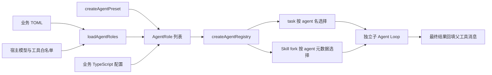

# 共享 Agent 角色、可选预设与 TOML 配置

`createAgentRegistry` 保存宿主定义的角色配置。`createTaskTool({ registry })`、`createSkillTool({ fork: { registry } })` 和 `createDeepAgent({ registry })` 可以复用同一目录。角色包含名称、选择说明和 `AgentConfig`；共享配置不共享运行中的消息、todos、计数器或检查点。

## 从角色定义到执行



主模型仍决定调用哪个工具、选择哪个 task 角色或 Skill。Skill 选中后按 `agent` 名称查注册表，不额外调用模型匹配执行者。TOML 加载属于宿主初始化，不是模型可以调用的创建 Agent 工具。

## 可选预设

| 名称              | 职责                           | 工具边界                                     |
| ----------------- | ------------------------------ | -------------------------------------------- |
| `general-purpose` | 独立分析、文件任务与验证       | 宿主提供的工具，移除 `delegates=true` 的工具 |
| `explorer`        | 只读探索代码、资料、调用链     | 仅保留 `effect=read` 且非委派工具            |
| `worker`          | 按任务范围修改文件、实现与验证 | 宿主提供的工具，移除委派工具                 |

预设是提示词和工具边界的组合，不自带模型客户端、文件 backend 或进程执行器，也不会自动获得主 Agent 的工具。`general-purpose` 与 `worker` 的权限上限相同，职责提示词与选择描述不同；更细权限由不同的工具集合、backend 和 `allowTool` 实现。

过滤既发生在创建预设时，也发生在宿主 `beforeAgent` 中间件之后。`explorer` 同时保留宿主 ACL，只读声明不会覆盖原有拒绝规则。`effect`、中间件和工具实现属于受信任宿主代码；将写入工具错误标记为 read 或在回调中直接产生副作用，并不会被这些过滤变成安全操作。这不是 OS 沙箱。

## 一次注册，同时接入 task 和 Skill

以下代码运行在仓库根目录完成构建后的 ESM 脚本中。`model`、`fastModel`、`backend` 和 `store` 是宿主已创建的实例。

```typescript
import {
  createAgentPreset,
  createAgentRegistry,
  createDeepAgent,
  createFileTools,
  createFilesystemSkills,
  createSkillTool,
  createTaskTool,
  loadAgentRoles,
} from "./dist/index.js";

const defaults = {
  model,
  tools: createFileTools({ backend }),
  checkpoints: { store, namespace: "coding-roles-v1" },
};

const registry = createAgentRegistry({
  defaultAgent: "general-purpose",
  roles: [
    createAgentPreset("general-purpose", defaults),
    createAgentPreset("explorer", defaults),
    createAgentPreset("worker", defaults),
    ...(await loadAgentRoles({
      root: ".enio/agents",
      defaults,
      models: { fast: fastModel },
    })),
  ],
});

const skill = await createSkillTool({
  backend: createFilesystemSkills({ root: ".enio/skills" }),
  fork: { registry, models: { fast: fastModel } },
});

const agent = createDeepAgent({
  model,
  registry, // 自动创建 task，角色名单完全由 registry 决定。
  tools: [skill], // Skill 始终是工具，没有新增独立 skills 字段。
  checkpoints: { store, namespace: "coding-root-v1" },
});
await agent.run(
  { input: "审查订单代码。" },
  {
    context: {},
    checkpointOwner: "current-session",
  },
);

// 不用 DeepAgent 时，把这个 task 工具显式放入 createAgent 的 tools 即可。
const task = createTaskTool({ registry });
```

`registry.list()` / `get(name)` 返回配置容器的副本；模型、backend、store 和宿主回调仍复用原实例。注册表要求 1–200 个角色，不允许名称重复。只有一个角色时自动成为默认角色；多个角色未配置默认值时，fork Skill 必须显式写 `agent`。task 的 `agent` 参数始终必填，默认角色只用于省略了 `agent` 的 Skill。

## 用 TOML 定义业务 Agent

例如 `.enio/agents/order-reviewer.toml`：

```toml
name = "order-reviewer"
description = "审查订单创建、支付和退款的状态流转及幂等处理"
preset = "explorer"
model = "fast"
tools = ["ls", "glob", "grep", "read_file"]
history = "isolated"

developer_instructions = """
先定位订单入口、状态定义以及支付回调。
检查状态流转、重复通知和退款幂等处理。
按严重程度输出发现，并给出文件位置与依据。
"""
```

借用了 Codex 的独立 TOML 文件和 `name`、`description`、`developer_instructions` 命名习惯；这是 enio-node 自己的受限配置格式，不承诺直接兼容所有 Codex TOML 字段。

| 字段                     | 必填 | 语义                                                                             |
| ------------------------ | ---- | -------------------------------------------------------------------------------- |
| `name`                   | 是   | 角色路由键：字母开头，后续为字母、数字、`_` 或 `-`，最多 64 字符                 |
| `description`            | 是   | 进入 task 工具说明，帮助主模型选择角色，最多 1 KiB                               |
| `developer_instructions` | 是   | 追加到宿主 instructions，最终作为子 Agent 的系统指令，最多 24 KiB                |
| `preset`                 | 否   | 三种内置预设之一；省略时使用自定义配置，不添加预设职责                           |
| `model`                  | 否   | `loadAgentRoles.models` 的键；省略时使用 `defaults.model`                        |
| `tools`                  | 否   | 只能引用 `defaults.tools`；省略继承该名单，`[]` 禁用所有工具，再与预设限制取交集 |
| `history`                | 否   | task 的 `isolated` / `inherit`；默认 isolated；不覆盖 Skill 的 context           |

`developer_instructions` 是字段名，在当前 ChatModel 协议中映射到 `instructions`，没有额外引入 developer 消息类型。模型别名只用于选择宿主实例；不读取 TOML 中的 API Key、URL 或可执行代码。模型推理强度、故障切换、ACL、hooks、预算与 checkpoint store 继续由 TypeScript 宿主配置，未支持字段直接报错。

只加载显式目录的一级普通 `.toml` 文件，按文件名排序；跳过符号链接与子目录，不递归搜索 `.codex/agents` 或用户主目录。目录不存在会报文件读取错误；空目录返回空列表，便于与预设组合。最多扫描 1000 个目录项、加载 200 个定义，每个文件不超过 32 KiB。

同名角色、未知模型/工具、错误类型、重复工具、未知字段和 TOML 语法错误都会让整次初始化失败，不返回部分注册表。错误不回显完整配置正文。修改文件后需要重新加载并重建注册表及 Agent，已创建的实例不会热更新。

## 同一角色用于 Skill

```yaml
---
name: order-audit
description: 根据订单审查流程检查状态和幂等处理
context: fork
agent: order-reviewer
---
分析本次任务指定的订单模块，逐项检查创建、支付回调与退款流程。
```

task 和这个 Skill 都获得 `order-reviewer` 的模型、工具、权限、中间件及预算。输入来源不同：task 传 `request`；Skill 传正文及可选 `request`。Skill 的 `fork` / `fork_with_context` 控制是否继承父历史，优先于角色为 task 设置的 history。

Skill 的 `model` 覆盖必须另外注册到 `fork.models`。它只改变该 Skill 子实例的模型，不修改共享角色，也不改变 task 的模型。

## 检查点与兼容性

- task 的子 namespace：`<角色 namespace>/task/<角色名>`。
- Skill 的子 namespace：`<角色 namespace>/skill/<技能名>/<角色名>/<模型键或default>`。
- 父级继续保存子检查点引用；重建注册表和 Agent 后可以沿原链路恢复，已完成工具不重放。
- 路由、工具、提示词或实现含义变化时升级宿主 namespace；不承诺旧运行恢复到新配置。
- 旧 `createTaskTool({ agents })`、`fork.agents`、`subAgents` 与未传 registry 的 DeepAgent 默认行为仍保留。新旧入口不能在同一个工具配置里混用。
- DeepAgent 收到 registry 后不再额外自动创建通用角色；需要它时显式把 `general-purpose` 预设放入注册表。此模式下不能同时提供非空 subAgents 或 `generalAgent: true`。

## 可运行示例

```bash
corepack pnpm run demo:roles
```

[examples/agent-roles.ts](../examples/agent-roles.ts) 加载 [report-reviewer.toml](../examples/agents/report-reviewer.toml)，通过 task 和 Skill 分别调用同一业务角色，再交给 worker 保存报告。使用内存文件与确定性模型，无需 API Key。

代码入口：`src/agents/registry.ts`（角色目录）、`src/agents/toml.ts`（TOML 加载）、`src/prebuilt/roles.ts`（预设）、`src/builtins/agent.ts` / `src/skills/skills.ts`（两种执行入口）。运行时继续复用原 Agent Loop。
