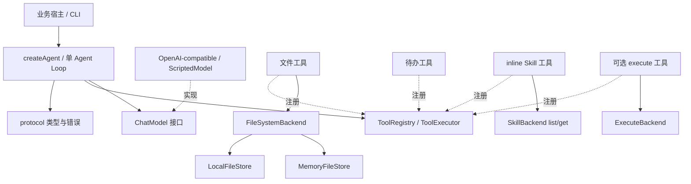

# 一期架构与扩展说明

## 模块依赖

`src/index.ts` 只聚合公共导出。核心 runtime 不导入具体 provider、本地文件实现或 CLI。更换模型、文件存储或 Skill 来源时实现相应接口即可，不需要修改循环。

| 路径                               | 阅读重点                                           |
| ---------------------------------- | -------------------------------------------------- |
| src/protocol/types.ts              | 消息／事件判别联合、ToolContext、配置和预算        |
| src/protocol/errors.ts             | 运行错误、可回填工具错误、模型重试错误             |
| src/runtime/agent.ts               | 唯一执行循环，run 与 stream 共享；每次运行独立状态 |
| src/runtime/control.ts             | deadline、取消等待、UTF-8 体积限制                 |
| src/runtime/history.ts             | 工具调用编号与历史配对检查                         |
| src/tools/registry.ts              | Schema 子集、创建期校验与运行期参数验证            |
| src/tools/executor.ts              | 权限、hook、执行、结果限量和未知副作用             |
| src/providers/openai-compatible.ts | SDK 通信、SSE 聚合与协议错误转换                   |
| src/backends/filesystem.ts         | 两类存储共享的权限、查询、冲突与锁语义             |
| src/backends/local-filesystem.ts   | 路径分量校验、受限读取、排他创建和原子替换         |
| src/backends/memory.ts             | 可重复的离线存储实现                               |
| src/skills/skills.ts               | 元数据发现、inline 正文加载和配置拒绝              |
| src/backends/process.ts            | 显式授权、shell=false、有界输出和进程组清理        |

## 循环及不变量

每轮先检查预算，再生成请求快照，随后聚合完整模型响应。只有 finishReason 正常、工具批次结构合法且总预算充足，才追加 assistant 消息并执行工具。每个调用经过“注册查找→JSON 解析→Schema 校验→宿主权限→beforeTool→execute→结果规范化”，结果通过 toolCallId 追加回历史。

整个批次在开始副作用前检查编号重复、数量上限和参数体积。单个调用参数错误允许回填并继续，取消或致命错误停止余下调用，保留未完成编号。没有工具的正常模型回复才生成 completed；一期没有 returnDirectly。

工具和 provider 都不直接修改消息历史。固定 instructions 只在每次请求组装时加入，不写入历史，因此宿主复用历史时不会重复累计指令。业务 context 可包含客户端，Runner 不克隆客户端；上下文类型只读，业务不应在并发 run 中修改共享身份。

## 取消和资源生命周期

每次 stream 有独立 AbortController；运行、模型、工具 deadline 形成父子作用域。return()/break 主动取消引擎，SDK 关闭 SSE，执行 backend 清理进程组。作用域退出时释放 timer 与父信号监听器。

异步生成器按消费者 next 的速度拉取，避免另建无限缓冲队列。对不响应取消的 Promise，框架结束等待并吸收迟到的拒绝；不能声称停止了底层操作。带副作用的调用中止或出现未分类错误时，返回 outcomeUnknown。

## 扩展业务工具

实现 `Tool<A, C>`，显式声明 effect 和 JSON Schema，并在 execute 中把 signal 传给业务客户端。身份来自 context，模型参数只表达业务意图。预期业务失败使用 ToolError；程序错误保留为异常，由 Runner 终止运行。不要在 execute 返回后继续启动后台写入。

Schema 的类型不会自动推导到泛型 A；作者须保持二者一致，运行时以 Schema 为准。可移植子集包括 object/array/标量、required、enum、数值／长度边界，不支持 $ref、格式扩展、复杂组合 Schema。业务需要扩展时应同时新增 provider 兼容测试。

`allowTool` 和 beforeTool 可以拒绝调用，不能改写已验证参数来绕过权限。beforeModel 可返回当前请求附加指令；onEvent 只观察独立快照，回调错误不改变业务结果。耗时观察工作应由业务显式投递到自己的有界日志系统。

## 与方案的落地差异

| 方案点                  | 实现决策                               | 原因                                                  |
| ----------------------- | -------------------------------------- | ----------------------------------------------------- |
| agent-runtime-ts 工作名 | enio-node                              | 按用户指定项目名创建                                  |
| 自动 skills 配置        | await createSkillTool 后显式加入 tools | 将文件发现错误前置，保持 createAgent 同步且无隐藏 I/O |
| 通用事件缓冲            | 拉取式 async iterator                  | 直接背压，减少队列、关闭与丢事件的额外状态            |
| 文件原子写入            | 新文件排他创建；覆盖临时文件＋rename   | 不承诺文件创建失败时回滚或多文件事务                  |
| 正式发布与真实模型验收  | private 包；真实测试显式启用           | 当前先交付本地代码；尚无模型端点和凭证                |

## 后续阶段

二期需要版本化的持久状态、工具边界恢复、审批、业务幂等键和隔离 backend。三期再按需求补上下文压缩、长结果外置、MCP 和动态工具发现。子 Agent／Workflow／Graph 应独立设计执行与恢复语义，不把当前循环改成隐藏编排器。

参考源码：Eino commit `58d184303f4e73413c454a9626f79c17af0fd9fb` 的 `adk/chatmodel.go`、`adk/react.go`、`compose/tool_node.go`、`components/tool/interface.go` 及 `adk/middlewares/`。当前代码为独立 TypeScript 实现，没有复制其 Go 图执行器。
