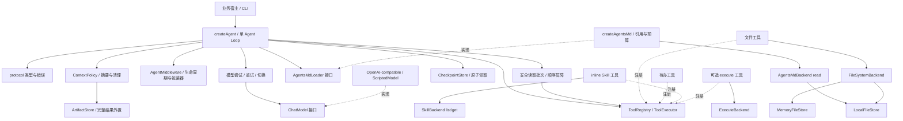
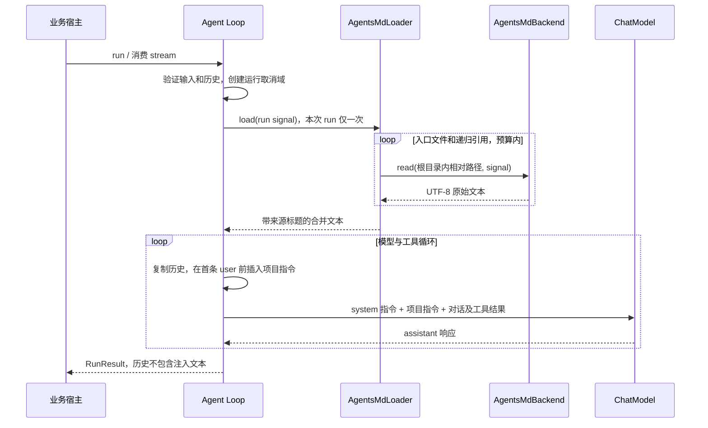

# 架构与扩展说明

## 模块依赖

`src/index.ts` 只聚合公共导出。核心 runtime 不导入具体 provider、本地文件实现或 CLI。更换模型、文件存储或 Skill 来源时实现相应接口即可，不需要修改循环。

| 路径                               | 阅读重点                                           |
| ---------------------------------- | -------------------------------------------------- |
| src/protocol/types.ts              | 消息／事件判别联合、ToolContext、配置和预算        |
| src/protocol/errors.ts             | 运行错误、可回填工具错误、模型重试错误             |
| src/runtime/agent.ts               | 唯一执行循环，run 与 stream 共享；每次运行独立状态 |
| src/runtime/model-call.ts          | 模型包装、候选切换、流协议与重试                   |
| src/runtime/tool-batch.ts          | 受控并发、有限预取、中断收尾                       |
| src/runtime/control.ts             | deadline、取消等待、UTF-8 体积限制                 |
| src/runtime/history.ts             | 工具调用编号与历史配对检查                         |
| src/tools/registry.ts              | Schema 子集、创建期校验与运行期参数验证            |
| src/tools/executor.ts              | 权限、hook、执行、结果限量和未知副作用             |
| src/providers/openai-compatible.ts | SDK 通信、SSE 聚合与协议错误转换                   |
| src/backends/filesystem.ts         | 两类存储共享的权限、查询、冲突与锁语义             |
| src/backends/local-filesystem.ts   | 路径分量校验、受限读取、排他创建和原子替换         |
| src/backends/memory.ts             | 可重复的离线存储实现                               |
| src/skills/skills.ts               | 元数据发现、inline 正文加载和配置拒绝              |
| src/instructions/agents-md.ts      | 项目指令来源协议、引用展开、去重、告警与字节预算   |
| src/backends/local-agents-md.ts    | 把 LocalFileStore 接入项目指令加载器               |
| src/backends/process.ts            | 显式授权、shell=false、有界输出和进程组清理        |
| src/context/                       | 模型调用前摘要/清理，工具结果外置                  |
| src/runtime/state.ts               | 快照导出、JSON 校验、检查点尾部工具配对校验        |
| src/runtime/interrupt.ts           | 工具执行前的中断请求                               |
| src/backends/context-stores.ts     | 内存/文件 ArtifactStore 与一次领取检查点           |
| src/builtins/artifacts.ts          | 外置内容 UTF-8 字节分页读取                        |

## 循环及不变量

每次运行先经 beforeAgent 装配指令与工具。每轮先完成已有工具批次，再检查下一次模型调用预算，执行旧 beforeModel hook、上下文策略、请求组装和 middleware.beforeModel；随后经 wrapModel 调用模型、重试或切换候选，聚合完整响应，再经 afterModel 验证。只有 finishReason 正常、工具批次结构合法且总预算充足，才追加 assistant 消息并执行工具。每个调用经过“注册查找→JSON 解析→Schema 校验→宿主权限→beforeTool→wrapTool→stream 或 execute→结果外置策略→硬性限量”，最终结果通过 toolCallId 追加回历史；进度只发出 tool_output。beforeTool 可以返回中断请求，待当前只读批次收尾后保存状态并结束当前事件流。

整个批次在开始副作用前检查编号重复、数量上限和参数体积。单个调用参数错误允许回填并继续，取消或致命错误停止余下调用，保留未完成编号。没有工具的正常模型回复，或同批工具全部完成且 returnDirect 工具成功时生成 completed；结束前执行 middleware.afterAgent，再执行旧 hooks.afterAgent。

工具和 provider 都不直接修改消息历史。固定 instructions 只在每次请求组装时加入，不写入历史，因此宿主复用历史时不会重复累计指令。业务 context 可包含客户端，Runner 不克隆客户端；上下文类型只读，业务不应在并发 run 中修改共享身份。

## AGENTS.md 项目指令链路

`AgentConfig.agentsMd` 只依赖 `protocol/types.ts` 中的加载器契约，runtime 不导入文件系统。`createAgentsMd` 负责来源顺序、相对引用、循环检测、UTF-8 截断与告警；`createFilesystemAgentsMd` 使用 `LocalFileStore` 提供受限本地读取。项目指令无需工具调用，因此不进入工具注册表，不消耗工具调用次数，也不走工具参数校验或 `allowTool`。加载用的 ACL 由宿主所选 backend 提供。

缓存是 engine 的局部变量，而不是加载器或 Agent 的共享状态。首次模型请求之前加载一次，后续轮次和网络重试复用；同一 Agent 的下一次 run 重新读取。缺失／空结果也在当前 run 固定，避免工具中途创建文件导致规则悄然改变。模型请求和返回历史分开维护，复用历史不会累积指令副本；注入文本计入 `maxInputBytes`。

对齐 Eino `adk/middlewares/agentsmd` 的核心行为：显式配置来源、递归引用、运行内复用和临时 user 消息。当前实现更明确地限制本地工作区范围，不自动搜索祖先目录；文件总数有上限，默认启用字节预算，最终文本的标题和截断提示也计入预算。V3 已增加通用 AgentMiddleware 接口，agentsMd 保留专用加载入口；没有复制 Eino 的 RunLocal/State API。

## 取消和资源生命周期

每次 stream 有独立 AbortController；运行、模型、工具 deadline 形成父子作用域。return()/break 主动取消引擎，SDK 关闭 SSE，执行 backend 清理进程组。作用域退出时释放 timer 与父信号监听器。

异步生成器按消费者 next 的速度拉取。显式开启安全读取并发时，每个工具最多挂起一次 next；已启动的 I/O 可以继续，进程 backend 只缓存输出预算内的日志，避免无限缓冲队列。对不响应取消的 Promise，框架结束等待并吸收迟到的拒绝；不能声称停止了底层操作。带副作用的调用中止或出现未分类错误时，返回 outcomeUnknown。

## 扩展业务工具

实现 `Tool<A, C>`，显式声明 effect 和 JSON Schema，并在 execute 中把 signal 传给业务客户端。身份来自 context，模型参数只表达业务意图。预期业务失败使用 ToolError；程序错误保留为异常，由 Runner 终止运行。不要在 execute 返回后继续启动后台写入。

Schema 的类型不会自动推导到泛型 A；作者须保持二者一致，运行时以 Schema 为准。可移植子集包括 object/array/标量、required、enum、数值／长度边界，不支持 $ref、格式扩展、复杂组合 Schema。业务需要扩展时应同时新增 provider 兼容测试。

`allowTool` 和 beforeTool 可以拒绝调用，不能改写已验证参数来绕过权限。beforeModel 可返回当前请求附加指令；onEvent 只观察独立快照，回调错误不改变业务结果。耗时观察工作应由业务显式投递到自己的有界日志系统。

## 与方案的落地差异

| 方案点                  | 实现决策                               | 原因                                                  |
| ----------------------- | -------------------------------------- | ----------------------------------------------------- |
| agent-runtime-ts 工作名 | enio-node                              | 按用户指定项目名创建                                  |
| 自动 skills 配置        | await createSkillTool 后显式加入 tools | 将文件发现错误前置，保持 createAgent 同步且无隐藏 I/O |
| 通用事件缓冲            | 拉取式 async iterator                  | 直接背压，减少队列、关闭与丢事件的额外状态            |
| 文件原子写入            | 新文件排他创建；覆盖临时文件＋rename   | 不承诺文件创建失败时回滚或多文件事务                  |
| 正式发布与真实模型验收  | private 包；真实测试显式启用           | 当前先交付本地代码；尚无模型端点和凭证                |

## 长上下文与恢复

`contextPolicies` 是 V2 的持久化上下文扩展接口；V3 新增 `middlewares` 用于生命周期、临时请求改写和调用包装。两者职责不同，不把临时指令写回工作历史，也未移植 Eino 的全套状态 API。beforeModel 按顺序接收隔离快照，可以返回新的完整工作历史；runtime 校验工具配对，并保留压缩前的调用 ID。afterTool 在硬截断之前拿到完整工具结果。策略不能直接修改运行中的历史数组。

成功结束时提供 `AgentSnapshot` 和可等待的 `afterAgent` 钩子，用于宿主持久化。中断则存储含未完成尾部批次的 Checkpoint，通过 resume 优先执行待完成调用。存储的 take 必须原子校验并消费，恢复重新校验权限；context、模型实例和工具实现由宿主重新提供。

具体默认值、状态区分、流程图与恢复限制见 [长上下文与恢复指南](context-and-resume.md)。

## V3 单 Agent 扩展

默认串行，只有显式声明 parallelSafe 的只读工具才进入并发批次；写入、命令和 returnDirect 工具形成顺序屏障。中断等待同批只读调用结束后保存剩余队列，避免恢复时重复读取。模型故障切换由 model-call 管理，成功候选在当前 run 中优先使用；已展示文本后禁止重放。完整契约和示例见 [V3 单 Agent 指南](v3-single-agent.md)。

## 后续阶段

本阶段已覆盖版本化状态、工具执行前的中断恢复、摘要与长结果外置。业务审批界面、幂等与补偿、隔离 backend、MCP 和动态工具发现按需补充。子 Agent／Workflow／Graph 应独立设计执行与恢复语义，不把当前循环改成隐藏编排器。

参考源码：Eino commit `58d184303f4e73413c454a9626f79c17af0fd9fb` 的 `adk/chatmodel.go`、`adk/react.go`、`compose/tool_node.go`、`components/tool/interface.go` 及 `adk/middlewares/`。当前代码为独立 TypeScript 实现，没有复制其 Go 图执行器。
