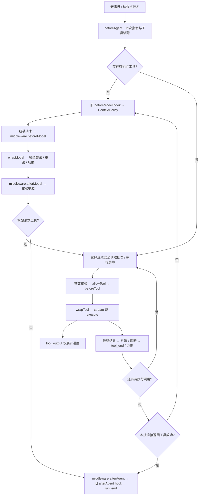

# V3：完善单 Agent

V3 在 V2 的摘要、结果外置、状态导出和工具执行前中断恢复之上，增加中间件、工具流式输出、受控并发、工具直接返回和主模型故障切换。机制参考 Eino，API 为独立 TypeScript 设计；不包含子 Agent、Workflow、Graph，也不声称与 Eino 全量功能等价。

不配置新增选项时，已有工具继续串行执行，原有 hooks、contextPolicies、run/stream/resume 接口保持有效。`Tool.execute` 仍必填；`Tool.stream` 可选。新增事件可能影响业务自己的穷尽 switch，需要处理 `tool_output` 和 `model_fallback`。

运行 `corepack pnpm run demo:v3` 可观察完整链路。示例真实读取仓库资料，使用脚本模型模拟主模型失败、备用模型连续调用、两次并发读取、工具进度和报告直接交付，不调用真实模型。

## 接入与执行顺序

```typescript
const agent = createAgent({
  model: primaryModel,
  modelFailover: { models: [backupModel] },
  middlewares: [requestContext, trace],
  tools: [lookup, deliver],
  toolExecution: { maxConcurrency: 2 },
  contextPolicies: [reduction, summarization], // V2 配置仍然有效
});
```



`beforeTool` 返回中断时，等同批只读调用收尾后保存检查点，返回 `interrupted`；不进入成功结束钩子。错误和取消仍按原有错误分类终止或回填。

## 中间件契约

| API                             | 调用时机                         | 可做什么                                                            |
| ------------------------------- | -------------------------------- | ------------------------------------------------------------------- |
| `beforeAgent(setup, ctx)`       | 每次新运行或恢复装配时           | 返回当前 run 的 instructions 和工具列表，例如按宿主身份注册业务工具 |
| `beforeModel(request, ctx)`     | 每轮一次，ContextPolicy 后       | 返回临时请求，增加消息、筛选工具；不修改持久化工作历史              |
| `wrapModel(request, ctx, next)` | 每个模型尝试，包括重试、备用模型 | 追踪、缓存、转换流；`ctx` 含 modelIndex/attempt                     |
| `afterModel(response, ctx)`     | 模型流完整结束且初步验证通过后   | 返回新的响应，再次验证协议；不能悄悄改掉已展示的流式文本            |
| `wrapTool(call, ctx, next)`     | 参数、权限、beforeTool 通过后    | 追踪、转换工具进度与结果；不接管权限或中断策略                      |
| `afterAgent(snapshot, ctx)`     | 成功或直接返回完成时             | 等待持久化最终工作快照；失败会导致 run 失败                         |

普通钩子按注册顺序执行；包装器按 `A(B(endpoint))` 嵌套。模型和工具包装器都返回 `AsyncIterable`，每个包装器的 `next` 最多调用一次，避免重复请求或副作用。包装器可直接返回缓存流，但仍须满足最终片段协议；工具缓存仍经过权限检查。中间件是受信任的宿主代码，其自建 I/O 必须使用传入 signal。

```typescript
const trace: AgentMiddleware<AppContext> = {
  name: "trace", // 同一 Agent 内名称唯一
  beforeModel(request, ctx) {
    return {
      ...request,
      tools: request.tools.filter((tool) => ctx.context.enabledTools.includes(tool.name)),
    };
  },
  async *wrapModel(request, ctx, next) {
    const started = Date.now();
    try {
      yield* next(request);
    } finally {
      recordDuration(ctx.runId, ctx.modelIndex, Date.now() - started);
    }
  },
  async *wrapTool(call, ctx, next) {
    for await (const chunk of next()) {
      if (chunk.type === "text_delta") recordProgress(ctx.runId, call.id, chunk.text);
      yield chunk;
    }
  },
};
```

`beforeModel`、`afterModel` 接收深拷贝；要让修改生效须返回新值。`beforeAgent` 可修改本次 setup 或返回新 setup，注册表随后再次验证并复制元数据。不要把跨 run 的可变游标放入中间件闭包，也不要修改共享业务 context。

`beforeModel` 可以筛选当前注册表的工具，改描述，但不能伪造工具 Schema 或添加未注册工具。增加工具在 `beforeAgent` 完成。模型仍请求被筛掉的已注册工具时，执行器回填 `tool_not_available`，不执行工具；未注册名称仍返回 `unknown_tool`。`wrapModel` 改写后也重新校验消息配对、工具定义与输入预算。

V2 的 ContextPolicy 会替换工作历史并进入快照，适合摘要和历史清理；V3 的 `beforeModel` 只修改本轮请求，适合临时提示、路由和工具筛选。摘要发生在 V3 请求改写之前，因此中间件新增的大量文本不触发第二次摘要，只受最终 `maxInputBytes` 硬限制。

`afterModel` 对非流式模型可改写文本；流式模型最终文本必须等于已输出片段拼接结果。需要改写流时在 `wrapModel` 同时转换增量和最终响应。缓存流也应提供对应的文本片段。`afterAgent` 仅用于成功状态保存，不是总会触发的资源清理钩子；资源应在包装器自己的 `finally` 中释放。

## 工具流式输出

```typescript
const inspect = defineTool<{ path: string }, AppContext>({
  name: "inspect",
  description: "读取并检查文件",
  effect: "read",
  inputSchema: {
    type: "object",
    properties: { path: { type: "string" } },
    required: ["path"],
    additionalProperties: false,
  },
  execute: inspectFile, // 保留非流式业务入口
  async *stream(args, ctx) {
    yield { type: "text_delta", text: "开始检查文件" };
    const result = await inspectFile(args, ctx);
    yield { type: "result", result }; // 恰好一次，而且必须是最后一个片段
  },
});
```

Runner 优先消费 `stream`；没有它才调用 `execute`，不会重复调用两个入口。进度变为 `tool_output`，包含工具调用 ID、名称、文本和可选 stdout/stderr 通道。最终结果经过 ContextPolicy.afterTool 与硬截断后，变成 `tool_end` 并写入历史。进度不进入 messages、摘要或检查点；需要保存日志时由宿主观察事件并持久化。

`createProcessBackend` 现在提供真实 stdout/stderr 流，`createExecuteTool` 自动接入；远端 backend 只实现旧的 execute 仍然可用。进程每次只启动一次，两个通道独立增量解码 UTF-8。输出按 backend.maxOutputBytes 受限，默认合计 24 KiB，超出部分丢弃并在最终结果标记 truncated；关闭消费会取消进程并清理普通进程组。

Runner 的 `maxToolStreamBytes` 默认 **1 MiB/次工具调用**，独立于最终结果 32 KiB 限制。超过进度预算终止运行，避免无限日志。缺少最终 result、重复 result 或 result 后继续产出片段，属于 `invalid_tool_stream`。执行途中抛出 ToolError 可回填模型；业务已交付最终结果之后，包装器或外置策略报错属于致命错误，避免将完成的写入误判为可重试失败。

背压约束的是框架继续拉取的速度。已启动的业务 I/O 和真实进程仍可能继续运行；并发执行器每个工具最多挂起一次 next，进程 backend 只缓存输出预算接纳的片段。不能把暂停消费理解成暂停操作系统进程。

## 受控并发与中断

只有同时满足下面条件才会并发：宿主设置 `toolExecution.maxConcurrency > 1`，工具 `effect: "read"`，且作者显式声明 `parallelSafe: true`。声明意味着不修改共享业务状态或 ToolContext.state；误给 write/execute 开启会在创建时拒绝。内置工具默认没有此标记，可由宿主审查 backend 后通过 `{ ...readTool, parallelSafe: true }` 显式开启。

调度只合并队头连续的安全读取，最大并发数范围 1–64。每批完全收尾再启动下一批；写入、命令、未声明安全的读取和直接返回工具都是顺序屏障。

```text
模型队列：readA* → readB* → writeC → readD* → readE* → deliver
并发数 2： [ A || B ]     →   C   → [ D || E ]     → deliver
* 表示 parallelSafe=true
```

并发进度和结果按完成顺序输出，按 toolCallId 与请求配对。每个并发工具拿到独立冻结的 todos 快照；宿主 context 仍由宿主负责共享只读约束。默认串行时维持原有 Todo 更新能力。

某个 beforeTool 请求中断时，等本批其他读取结束，先保存已完成结果，再保存未执行调用。多个调用同时中断时，按原队列顺序逐一确认；恢复数据只给当前中断调用。已完成读取不会因恢复而重做。若任何调用发生致命错误或取消，终止本批，不生成可重放检查点。不会把正在执行的工具强行保存成可恢复调用栈。

## 工具直接返回

给工具声明 `returnDirect: true`。成功时，把经过包装器、外置及截断后的 `result.content` 用作 `RunResult.finalText`，`stopReason` 为 `return_direct`，不再调用主模型改写。适合业务已经生成最终答复或报告的工具。

为了保持历史配对，同一模型批次内其他调用仍然完成；因此直接返回不是取消剩余工具的开关。同批最多一个直接返回调用，出现两个会在任何工具执行前以 `protocol_error` 失败。工具返回 ok=false 或 ToolError 时正常回填模型，不触发直接返回。直接返回成功后仍执行 afterAgent 并导出完整工作状态。

若直接返回工具已完成、后续调用中断，恢复后会从历史取出该结果，不重复执行已完成工具。下一轮通过 state 发起新对话时，仍正常调用模型，不会再次把上一轮的直接返回当作本轮回答。

## 主模型重试与故障切换

`modelFailover.models` 是有序备用模型列表，索引 0 表示主模型，1 起为备用模型。每个候选最多尝试 `1 + maxModelRetries` 次，默认重试 2 次；先耗尽当前模型的重试，再考虑切换。总运行超时继续约束整条链路。

默认仅对 `ModelError.retryable=true` 切换。可用 shouldFailover 对不可重试的 ModelError 增加显式策略，例如某个端点认证失败时允许切换其他凭证的模型。该回调不会覆盖取消、模型 deadline、协议错误或已经输出文本后的失败。框架的 model_timeout 默认终止本次 run，不做自动切换；适配器主动抛出的可重试网络超时 ModelError 则属于重试路径。

```typescript
modelFailover: {
  models: [backupModel],
  shouldFailover: (error) => error.retryable || error.code === "provider_auth_failed",
}
```

当前轮成功的模型在当前 run 后续轮次优先使用，失败时再尝试池中其他模型，每个候选每轮只进入一次。新 run 从主模型开始，检查点恢复则保留中断前的模型选择。所有候选都使用同一工具契约，宿主负责选择能力兼容的模型。

模型一旦输出非空 text_delta，就不再重试或切换，防止用户看到重复或相互矛盾的答案。tool_call 参数仍在 provider 内部聚合，完整校验前不会执行工具。`model_start`、`model_retry` 附带 modelIndex，切换另发 `model_fallback { from, to, code }`。失败尝试用量无法精确获知时，usage.known=false。

这个模型池只作用于主循环；摘要模型继续使用 createSummarization 的独立重试和 fallbackModels 配置。

## 与 V2 检查点的兼容

新增可选字段 modelIndex、setupSignature、availableTools，schemaVersion 仍为 1；没有启用 V3 扩展的配置保留 V2 绑定指纹。旧检查点缺少字段时使用主模型、基础工具集合，并补齐新增的进度预算默认值。已有 V2 快照也可继续作为新 run 的输入。

新检查点同时保留本轮可见工具列表及 beforeAgent 装配签名。恢复重新运行 beforeAgent 并核对指令、工具定义和行为标记；不一致会返回 checkpoint_mismatch。动态装配校验发生在 store.take 领取之后，因此这种失败会消费检查点，不能直接反复重试。用于恢复的装配须稳定，身份或功能开关不应悄悄改变待恢复工具。

函数实现、模型身份与中间件内部配置无法序列化比较，变更时宿主仍须升级 checkpoints.namespace。中间件名称和备用模型数量只能辅助检测，不能代替业务版本管理。

## 源码与验证

| 文件                        | 职责                                                   |
| --------------------------- | ------------------------------------------------------ |
| `src/protocol/types.ts`     | 中间件、ToolChunk、故障切换、事件与检查点契约          |
| `src/runtime/agent.ts`      | 每次运行装配、生命周期顺序、结果落历史、直接返回与恢复 |
| `src/runtime/model-call.ts` | 模型包装、逐模型重试、切换、流协议与取消               |
| `src/runtime/tool-batch.ts` | 连续安全读取调度、有限预取、中断收尾                   |
| `src/tools/registry.ts`     | 工具元数据、行为标记与当前请求工具定义验证             |
| `src/tools/executor.ts`     | 权限后的工具包装、进度协议、最终结果处理               |
| `src/backends/process.ts`   | 进程实际输出流、字节上限、UTF-8、取消清理              |
| `tests/v3-*.test.ts`        | 中间件、并发、直接返回、流式进程、故障切换与恢复边界   |

完整验证命令和环境见 [验收记录](acceptance.md)，V2 接入见 [长上下文与恢复指南](context-and-resume.md)。
