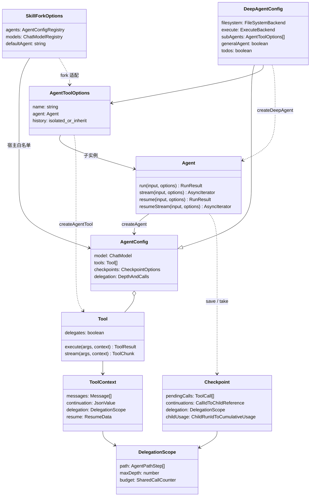
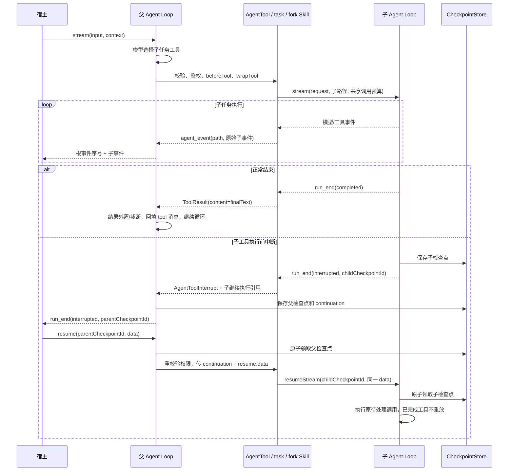

# V4：子 Agent、Skill fork 与预置装配

V4 在现有 Agent Loop 上增加子任务层：`createAgentTool` 把独立 Agent 变成普通工具，`createTaskTool` 提供命名路由，Skill 可以在子 Agent 中执行，`createDeepAgent` 负责常见工具组合。核心循环仍只有 `src/runtime/agent.ts` 一份。Chain、Workflow、Graph 留在 V5。

这是对 Eino 核心行为的独立 TypeScript 实现，参考 `adk/agent_tool.go`、`adk/prebuilt/deep/` 和 `adk/middlewares/skill/`。不兼容其 Go API、事件 Action 或序列化检查点，也未实现 Eino 的动态 transfer/supervisor 全套编排。

## 对象和依赖



| 文件                        | 职责                                            |
| --------------------------- | ----------------------------------------------- |
| `src/builtins/agent.ts`     | AgentTool、task 路由、子事件适配、子检查点引用  |
| `src/runtime/agent.ts`      | 传播上下文、汇总子事件和用量、保存/恢复引用     |
| `src/runtime/delegation.ts` | 路径/预算/事件验证、完整历史筛选                |
| `src/runtime/interrupt.ts`  | 内部 AgentToolInterrupt；公开入口仍是 interrupt |
| `src/tools/executor.ts`     | 委派仍经过权限、中间件、超时与输出预算          |
| `src/skills/skills.ts`      | inline / fork / fork_with_context 和注册表选择  |
| `src/prebuilt/deep.ts`      | 预置指令、基础工具、通用和专用子 Agent 装配     |

## 最小接入

下面示例中 `model` 是宿主创建的 ChatModel，`readonlyBackend` 是业务配置的文件 backend。导入路径适用于仓库根目录完成构建后的脚本。

```typescript
import { createAgent, createAgentTool, createFileTools } from "./dist/index.js";

const reviewer = createAgent({
  model,
  instructions: "阅读资料，返回有来源的分析结果。",
  tools: createFileTools({ backend: readonlyBackend }),
});
const agent = createAgent({
  model,
  tools: [
    createAgentTool({
      name: "reviewer",
      description: "分析文件资料并输出结论",
      agent: reviewer,
      history: "isolated", // 默认值；只传本次 request。
    }),
  ],
  delegation: { maxDepth: 4, maxCalls: 32 },
});
await agent.run({ input: "请分析指定资料" }, { context: {} });
```

父模型看到的函数参数只有 `{ request: string }`。模型不会拿到子模型配置、凭证或任意 Agent 构造入口。宿主也可以使用 `createTaskTool({ agents: [...] })`，让一个 `task` 工具接收 `{ agent, request }`；agent 字段是注册名称的枚举。

`effect` 默认 execute，以保守处理可能发生的子任务写入。只有确认整棵子树都只读时才声明 read。委派工具设置 `delegates: true`，始终串行；与 parallelSafe 同时声明会在创建时被拒绝。V3 的普通只读工具并发仍可使用。

## 一次调用经过哪些阶段



子 Agent 正常结束时只有 finalText 变成父级 tool 结果；子消息、工具结果和 todos 不自动合并。子工具的 returnDirect 只结束子运行，父级仍继续。父模型需要直接交付整个子结果时，可以在父级 AgentTool 上单独声明 returnDirect。

## 隔离与共享的边界

| 数据                     | 默认行为                                                                                                            |
| ------------------------ | ------------------------------------------------------------------------------------------------------------------- |
| 消息与 todos             | 每个子 run 独立，父级只回填子任务最终文本                                                                           |
| history: inherit         | 复制过去完整对话，排除当前整个未完成工具批次和 system 消息                                                          |
| instructions / AGENTS.md | 使用子 Agent 自己的配置；父请求临时注入的指令不会复制                                                               |
| 业务 context             | 传同一宿主上下文，不复制客户端，也不改变身份；业务不得修改共享身份                                                  |
| 工具/模型/ACL/中间件     | 使用子配置；父 allowTool 控制能否委派，子 allowTool 控制具体工具                                                    |
| 文件与外部服务           | 由 backend 决定；复用 backend 意味着可访问同一资源，并非进程或文件沙箱                                              |
| 取消                     | 父运行 signal → 父工具 signal → 子运行 signal；取消逐层传播                                                         |
| 状态导出                 | 根 snapshot 只包含根上下文；需要保存子快照时配置子 afterAgent                                                       |
| 外置结果                 | 每个 Agent 使用自己的 ContextPolicy；继承含 artifact 引用的父历史时，宿主须显式为子提供对应读取工具和可访问的 store |

嵌套事件是面向宿主的观察数据，可能包含子对话和工具结果；“父模型不自动看到”并不等于这些内容对事件消费者不可见。展示和日志权限由宿主管理。

## 事件与预算

```typescript
for await (const event of agent.stream(input, options)) {
  if (event.type === "agent_event") {
    const { path, event: child } = event.payload;
    // path 每段包含 name、parentRunId、toolCallId。
    console.log(path.map((step) => step.name).join("/"), child.runId, child.seq, child.type);
  }
  if (event.type === "run_end") console.log(event.payload.result);
}
```

外层 runId / seq 属于根运行，内层保持子运行自己的 runId / seq。孙级通过更长的 path 表示，不反复套 agent_event 信封。只处理根 run_end 判断整个任务完成，不能把子 run_end 当作全部结束。

| 预算              | 语义                                                                                                         |
| ----------------- | ------------------------------------------------------------------------------------------------------------ |
| maxDepth          | 默认 4，范围 0–16；根路径长度为 0，0 禁止启动子 Agent；子配置可收紧最大绝对路径深度                          |
| maxCalls          | 默认 32，范围 1–1024；由根控制全树累计启动次数，子配置不重置；恢复同一子运行不消耗新次数                     |
| 模型轮数/工具次数 | 每个 Agent 自己计数；父 toolCalls 只统计委派工具及父自己的工具                                               |
| 超时              | 子任务仍是父工具调用，默认受父 toolTimeoutMs=30s 限制，也受父/子 runTimeoutMs 限制；长任务须显式调大相应预算 |
| 事件体积          | 子事件完整 JSON 累计进入 maxToolStreamBytes，默认 1 MiB；包括子 run_end 中的历史/快照，未创建无限事件队列    |
| usage             | 父用量包含自身及整棵子树；仅累加直接子 run_end，孙级已计入子级；恢复按累计差额计算，避免重复计数             |

深度/启动次数耗尽会在新子任务启动前回填 `agent_depth_exceeded` / `agent_calls_exceeded`。子运行失败或取消会终止父运行，不伪装成可让模型重试的工具失败。中止时可能缺少完整子 usage，因此 known=false；副作用不确定时保留 outcomeUnknown。

## 嵌套中断恢复

需要中断的子 Agent 和所有祖先都必须配置 checkpoints。可以共用 store，但应使用稳定且区分业务实现的 namespace。父检查点仅持有子检查点引用，包含以下新增可选字段，旧 V2/V3 检查点可以缺省：

- `continuations`：父调用 ID → 子检查点与路由。
- `delegation`：当前路径、深度上限、全树调用计数。
- `childUsage`：已计入的直接子运行累计用量，恢复后只增加差额。

子检查点身份由宿主 owner、父 runId、父 toolCallId 和子名称派生。宿主只需对根提供 checkpointOwner 和确认数据；恢复重建同样配置的 Agent 树，框架沿引用链进入原子运行。原调用 ID、历史、todos、事件序号及预算继续沿用。

**恢复限制**：所有层的 store 必须仍可访问；缺失子检查点直接失败，不重新启动子任务。每层检查点各自一次领取，没有跨 store 的事务；父保存失败或恢复时拒绝父调用，可能留下未使用的子检查点，宿主需要自己的保留/清理策略。领取后异常不能自动回滚领取。允许继续的是明确保存的工具前暂停，不支持任意 JavaScript 调用栈、进程崩溃或未知写入自动重放。

更改模型路由、工具实现或业务权限含义时，应升级 namespace。V3 原绑定及装配签名在未启用新能力时保持兼容，真实旧标签生成的测试样本位于 `tests/fixtures/`；已有检查点不能直接恢复到增加了工具或改变了装配的配置。

## Skill 的三种模式

Skill 仍通过 `tools` 注册，没有独立 `skills` 配置字段。

```yaml
---
name: source-review
description: 读取资料并形成报告
context: fork
agent: reviewer
model: fast
---
先读取资料，再给出带来源的结论。
```

```typescript
const skillTool = await createSkillTool({
  backend: createFilesystemSkills({ root: skillsDirectory }),
  fork: {
    defaultAgent: "reviewer",
    agents: {
      reviewer: {
        model,
        tools: createFileTools({ backend: readonlyBackend }),
        checkpoints: { store, namespace: "reviewer-v4" },
      },
    },
    models: { fast: fastModel },
  },
});
const agent = createAgent({
  model,
  tools: [skillTool],
  checkpoints: { store, namespace: "parent-v4" },
});
```

| context           | 正文去向                                              | 父历史                              |
| ----------------- | ----------------------------------------------------- | ----------------------------------- |
| 省略或 inline     | 原样返回 Skill 正文，当前 Agent 后续解释执行          | 当前原对话                          |
| fork              | 正文和可选 request 作为子任务输入；父级接收子最终文本 | 不复制                              |
| fork_with_context | 同 fork，但先复制完整父对话                           | 排除当前批次、system 和临时注入文本 |

发现阶段名单、模式及注册名称进入工具描述，正文按调用才加载。只有 inline 时保持旧版参数 `{skill}`；含 fork 时允许 `{skill, request?}`。agent/model 只能选择宿主注册表的键，单个 Agent 可作为隐式默认，多 Agent 时需要 defaultAgent 或 Skill 显式选择。inline 不能切换 Agent 或模型；没有配置 fork 注册表时继续拒绝 fork 元数据。

Skill 子实例的检查点 namespace 自动加上技能、Agent 和显式模型键。恢复时验证路由，直接恢复子历史中的原正文，不调用 backend.get 重新读正文；重新创建工具仍会执行目录发现，因此元数据来源应可用且稳定。

Skill 文本不是可执行程序。它提出脚本执行需求时，子模型仍须调用已注册的 execute 工具，经 Schema、权限、命令白名单与超时处理。仅传 SkillBackend 不会授予文件读取、网络、命令或脚本目录访问权限。

## DeepAgent 风格预置层

```typescript
const agent = createDeepAgent({
  model,
  filesystem: backend, // 可选：加入六个文件工具。
  execute: processBackend, // 可选：显式加入 execute。
  tools: [skillTool], // Skill 仍是普通工具。
  subAgents: [{ name: "reviewer", description: "审阅资料", agent: reviewer }],
  checkpoints: { store, namespace: "coding-v4" },
  limits: { toolTimeoutMs: 90_000 },
});
```

默认添加 write_todos 和 task，task 内包含 general-purpose。通用子 Agent 继承宿主的模型、基础工具、ACL、hooks、中间件及上下文策略，排除基础列表里 delegates=true 的工具以避免隐式递归，并使用 `/general-purpose` 检查点 namespace。宿主的 beforeAgent 中间件若动态新增委派工具，仍受全树预算控制。专用子 Agent 使用传入的实例，不自动获得父工具或父 ACL。

`todos: false` 关闭自动待办；`generalAgent: false` 关闭默认通用子任务。没有任何子任务时不注册 task。工具同名会报错，自定义 general-purpose 时需关闭默认项。调用方可只传 model 使用预置分析助手，文件与进程能力都须显式提供 backend。

## 可运行示例与验证

```bash
corepack pnpm run demo:v4
```

`examples/subagents-v4.ts` 使用脚本模型和真实临时文件：fork Skill 只读指标 → 父 task 委派 writer → 子写入前中断 → 宿主提供确认 → 重建全部实例恢复 → 写入并回读。资料读取和报告写入均恰好一次，子 todos 不进入父状态，终端保留报告路径。无需 API Key，不产生模型费用。

新增测试覆盖隔离与继承、扁平嵌套事件、三层新实例恢复、身份绑定、取消与超时、调用预算、恢复用量去重、错误传播、Skill 白名单与正文恢复、预置工具装配、真实文件任务及 V3 检查点兼容。完整实际执行记录见 [验收记录](acceptance.md)。
